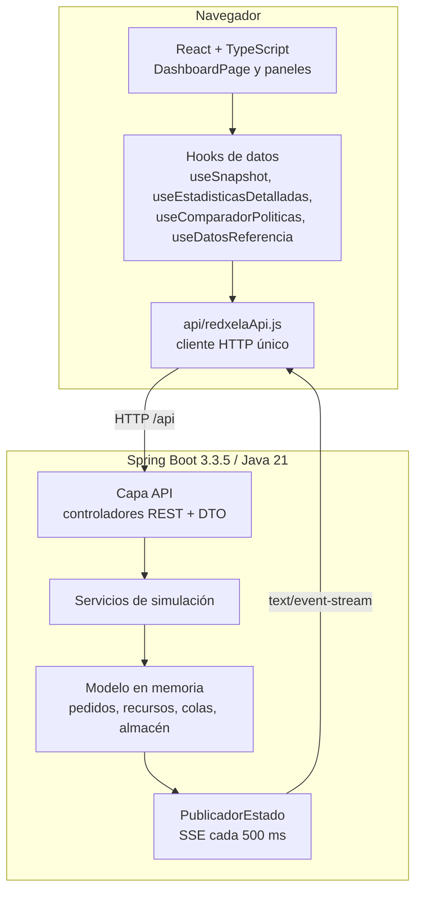
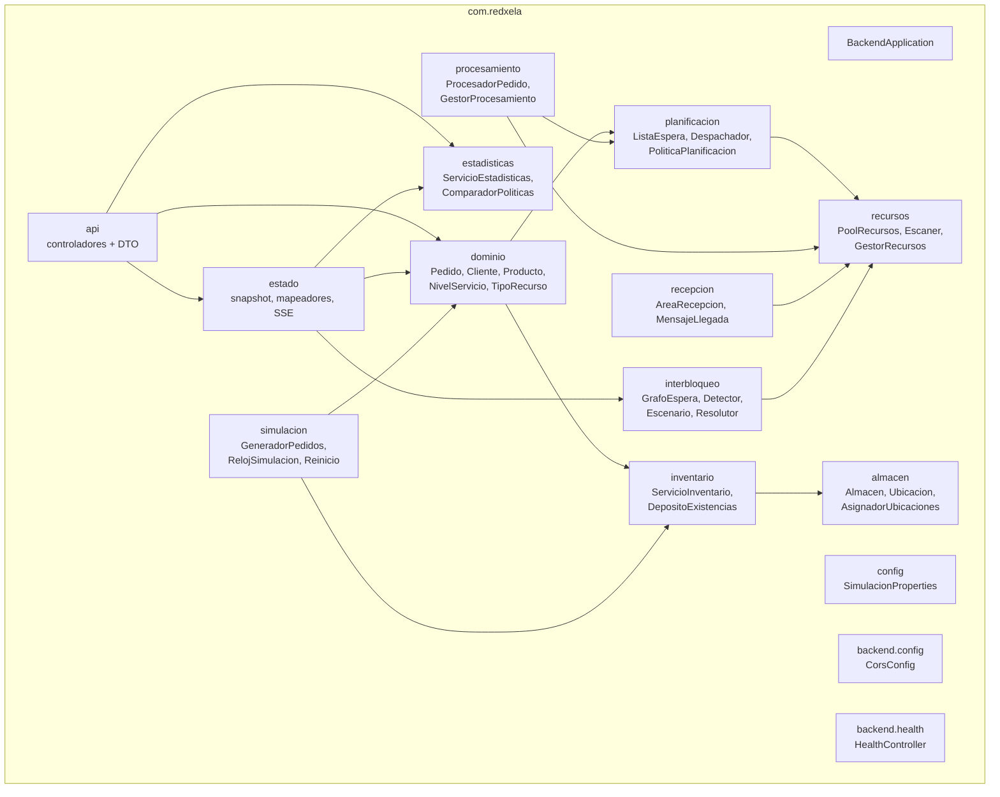
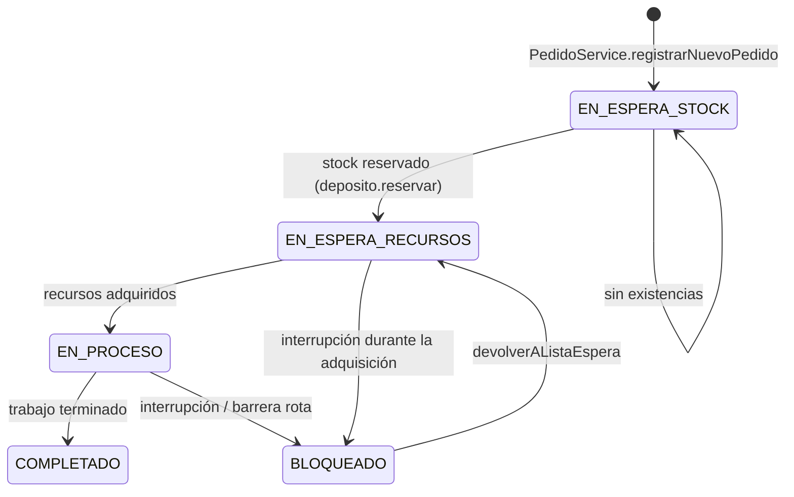
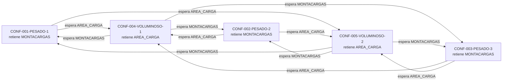
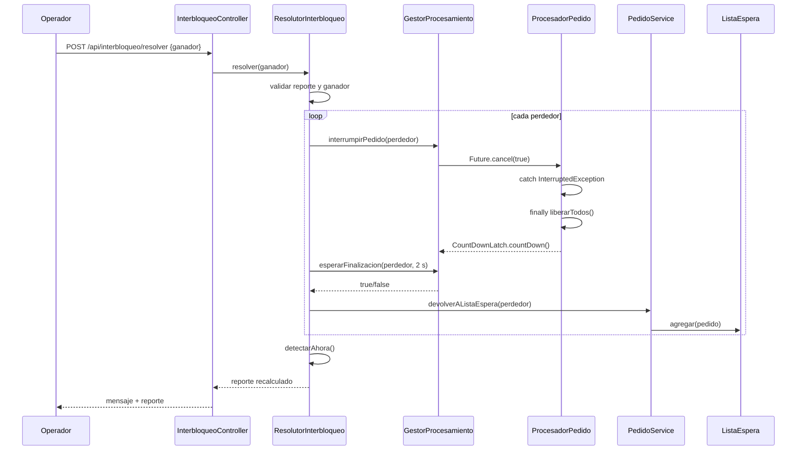

# Manual técnico — REDXela

**Proyecto:** simulador de centro de distribución de comercio electrónico  
**Curso:** Sistemas Operativos 2 — USAC CUNOC  

Este manual describe la infraestructura, la arquitectura y los mecanismos de sincronización del simulador REDXela.

---

## 1. Ficha técnica

| Elemento | Versión / tecnología |
|---|---|
| Lenguaje backend | Java 21 |
| Framework backend | Spring Boot 3.3.5 |
| Build backend | Maven Wrapper (`./mvnw`) |
| Pruebas backend | JUnit 5, Spring Boot Test, MockMvc, AssertJ |
| Gestión de dependencias | `pom.xml` |
| Frontend | React 18.3 + TypeScript 5.6 |
| Bundler | Vite 5.4 |
| Enrutamiento | React Router 6 |
| HTTP | Fetch API centralizada en `src/api/redxelaApi.js` |
| Estado en tiempo real | Server-Sent Events (SSE) |
| Contenedores | Docker + Docker Compose |
| Base de datos | Ninguna; estado en memoria |
| Puerto frontend | 5173 |
| Puerto backend | 8080 |
| Persistencia | No hay; el reinicio reconstruye el estado inicial |

---

## 2. Cómo ejecutar y verificar

### 2.1. Docker Compose

Desde la raíz:

```bash
docker compose up --build
```

Para detener:

```bash
docker compose down
```

### 2.2. Backend local

```bash
cd redxela_api
./mvnw spring-boot:run
```

Pruebas:

```bash
cd redxela_api
./mvnw test
```

Empaquetado:

```bash
./mvnw package
```

El `Dockerfile` ejecuta las pruebas en `mvn package`; si una prueba falla, la imagen no se construye.

### 2.3. Frontend local

```bash
cd redxela_client
npm install
npm run dev
```

El servidor Vite escucha en `0.0.0.0:5173`. El proxy de `vite.config.ts` redirige `/api` a `http://backend:8080`, que es el nombre del servicio dentro de Compose. Si el frontend corre en el host y el backend también, hay dos opciones:

1. Usar la URL absoluta:

   ```bash
   VITE_API_URL=http://localhost:8080/api npm run dev
   ```

2. Cambiar temporalmente el destino del proxy a `http://localhost:8080`.

El CORS del backend permite patrones de `localhost`, `127.0.0.1` y `frontend:*` en cualquier puerto local, por lo que la opción 1 funciona.

### 2.4. Verificación del frontend

```bash
cd redxela_client
npm run typecheck
npm run build
```

`typecheck` ejecuta TypeScript sin emitir; `build` ejecuta `tsc && vite build`. El proyecto se verificó con ambos comandos durante la fase de implementación.

### 2.5. Endpoints de salud

| Endpoint | Uso |
|---|---|
| `GET /api/health` | Respuesta propia del backend; usada por Docker Compose. |
| `GET /actuator/health` | Health estándar de Spring Boot Actuator. |

---

## 3. Arquitectura general

REDXela



### 3.1. Flujo de estado en vivo

1. `PublicadorEstado` ejecuta una tarea programada cada `publicacion-estado-ms` (500 ms por defecto).
2. `ServicioSnapshot.construir()` toma una foto de recursos, pedidos en proceso, cola de listos, almacén, reporte de interbloqueo y estadísticas.
3. `MapeadorEstado` y `MapeadorAlmacen` transforman las estructuras internas en DTO inmutables (`SnapshotEstado`).
4. El snapshot se envía por SSE a todos los suscriptores de `GET /api/stream/estado`.
5. `useSnapshot` recibe el evento, actualiza el estado de React y lo entrega a `DashboardPage`.
6. Si el navegador no implementa `EventSource`, `estadoStream.ts` usa polling a `GET /api/estado/snapshot` cada segundo. Si SSE falla, reintenta con espera exponencial.

### 3.2. Flujo de una acción de escritura

Ejemplo: alta de un pedido.

```text
FormularioPedido
  -> crearPedido() de redxelaApi.js
  -> POST /api/pedidos
  -> PedidoController (sin lógica de negocio)
  -> PedidoService.registrarNuevoPedido()
  -> DepositoExistencias.reservar() o EN_ESPERA_STOCK
  -> ListaEspera.agregar() + Despachador
  -> snapshot SSE
  -> paneles actualizados
```

Los controladores solo validan y delegan; la lógica de negocio vive en servicios y componentes del modelo.

---

## 4. Arquitectura del backend

### 4.1. Diagrama de paquetes



El diagrama muestra las relaciones principales. Los controladores delegan en los servicios y el paquete `estado` construye las vistas para el frontend.

### 4.2. Responsabilidades por paquete

| Paquete | Responsabilidad |
|---|---|
| `com.redxela` | Clase de arranque Spring Boot y escaneo de configuración. |
| `config` | `SimulacionProperties`, enlazada a `application.yml`. |
| `backend.config` | CORS para el frontend de desarrollo. |
| `backend.health` | Endpoint `/api/health` y DTO de salud. |
| `dominio` | Entidades y enums: `Pedido`, `Cliente`, `Producto`, `ItemPedido`, `TipoMercancia`, `TipoRecurso`, `NivelServicio`, `EstadoPedido`; servicios de clientes y pedidos; catálogo; despacho al finalizar. |
| `recursos` | `PoolRecursos`, `Escaner`, `GestorRecursos`, `EstadoRecurso`, `ModoPrevencion`. |
| `planificacion` | `PoliticaPlanificacion`, tres políticas, `TipoPolitica`, `ListaEspera`, `Despachador`, `ElementoListaEspera`. |
| `procesamiento` | `ProcesadorPedido`, `GestorProcesamiento`, `PedidoFinalizadoEvent`. |
| `recepcion` | `AreaRecepcion`, `MensajeLlegada`. |
| `inventario` | `ServicioInventario`, `DepositoExistencias`, `Lote`, `ConsumidorInventario`, `ReevaluadorPedidosStock`, `EventoLlegadaMercancia`. |
| `almacen` | `Almacen`, `Ubicacion`, `AsignadorUbicaciones`, `ResultadoAsignacion`, `AsignacionCelda`, `AlmacenLlenoException`. |
| `interbloqueo` | `GrafoEspera`, `DetectorInterbloqueo`, `EscenarioConflicto`, `SincronizadorConflicto`, `ResolutorInterbloqueo`, `ReporteInterbloqueo`. |
| `simulacion` | `GeneradorPedidos`, `RelojSimulacion`, `ServicioReinicio`. |
| `estadisticas` | `ServicioEstadisticas`, `ComparadorPoliticas`, `SimuladorPolitica`, `GeneradorCargaComparacion`. |
| `api` | Controladores REST, DTO de entrada/salida y `GlobalExceptionHandler`. |
| `estado` | `ServicioSnapshot`, `PublicadorEstado`, `MapeadorEstado`, `MapeadorAlmacen`. |

### 4.3. Modelo de dominio

#### Pedido como PCB

`Pedido` conserva los datos y el estado de cada pedido. Sus campos principales son:

- `id` único, `cliente`, `nivel`, `items`, `totalArticulos`.
- `tCreacion`, `tInicio`, `tFin` y `escalaTiempoMs`.
- `stockReservado`, que indica si se descontaron existencias para el pedido.
- `estado`, `progreso`, `recursoEsperado`.
- Conjunto concurrente `recursosRetenidos`.

`recursosRetenidos` usa `ConcurrentHashMap.newKeySet()` para que el hilo del pedido, el snapshot y el resolutor puedan consultarlo sin corromper la colección. La lista de ítems y el cliente son inmutables.

`ClienteService` inicia el contador después de los cinco clientes precargados. Al crear una cuenta usa `putIfAbsent` y, si el identificador ya existe, genera otro sin reemplazar la cuenta anterior.

#### Estados



Estados reales en `EstadoPedido`:

- `EN_ESPERA_STOCK`: bloqueado lógicamente por falta de existencias.
- `EN_ESPERA_RECURSOS`: en la cola de listos o adquiriendo recursos.
- `EN_PROCESO`: todos los recursos fueron adquiridos y el trabajo está ejecutándose.
- `BLOQUEADO`: interrumpido o detenido por una falla de sincronización.
- `COMPLETADO`: trabajo terminado.

#### Niveles de servicio

`NivelServicio` define prioridad y objetivo:

| Nivel | Número | Nombre | Objetivo SLA |
|---|---:|---|---:|
| `EXPRES` | 1 | Exprés | 1 min simulado |
| `PRIORITARIO` | 2 | Prioritario | 10 min |
| `ESTANDAR` | 3 | Estándar | 30 min |
| `PROGRAMADO` | 4 | Programado | 60 min |
| `ECONOMICO` | 5 | Económico | 120 min |

Los objetivos se usan para calcular la prioridad con envejecimiento y el cumplimiento del SLA. El enunciado no fija un valor numérico para Exprés; se usa un minuto simulado como umbral.

#### Recursos

`TipoRecurso` combina nombre, orden global y unidades por defecto:

| Recurso | Orden global | Unidades por defecto |
|---|---:|---:|
| `ENCARGADO_BODEGA` | 1 | 10 |
| `MONTACARGAS` | 2 | 3 |
| `AREA_CARGA` | 3 | 2 |
| `CONTROL_CALIDAD` | 4 | 4 |
| `ESTACION_EMPAQUE` | 5 | 6 |
| `ESCANER` | 6 | 1 |

El orden global es la base de la prevención de interbloqueos. Las unidades se cargan desde `application.yml`; las de `TipoRecurso` son valores por defecto del enum y se usan como referencia.

#### Productos y tipos de mercancía

`CatalogoProductos` carga 12 productos, dos por cada uno de los seis tipos de mercancía. `TipoMercancia` define la secuencia natural de recursos:

| Tipo | Secuencia natural |
|---|---|
| `FRAGIL` | Encargado → Control de calidad → Empaque |
| `PESADO` | Montacargas → Encargado → Área de carga |
| `VOLUMINOSO` | Área de carga → Montacargas → Empaque |
| `ELECTRONICO` | Control de calidad → Escáner → Empaque |
| `PERECEDERO` | Encargado → Empaque → Área de carga |
| `GENERAL` | Encargado → Empaque → Escáner |

La inversión entre `PESADO` (Montacargas antes de Área de carga) y `VOLUMINOSO` (Área de carga antes de Montacargas) es la base del escenario de conflicto.

---

## 5. Planificación de pedidos

### 5.1. Cola de listos

`ListaEspera` es una estructura **sin límite** basada en `ConcurrentHashMap<String, Pedido>`. Su operación crítica es `extraerSiguiente`:

1. Toma un `ReentrantLock` no justo (`cerrojoExtraccion`).
2. Si la cola está vacía, devuelve `Optional.empty()`.
3. Obtiene el comparador de la política activa para el instante actual.
4. Selecciona el mínimo con `min(comparador)`.
5. Remueve el pedido de forma atómica.
6. Libera el cerrojo en `finally`.

`obtenerVistaOrdenada` no toma el cerrojo de extracción: copia los valores y ordena una vista. Puede ser una vista ligeramente desactualizada, lo cual es aceptable para telemetría.

### 5.2. Despachador

`Despachador` es el único punto de salida de la cola:

```java
Optional<Pedido> siguiente = listaEspera.extraerSiguiente(politica, tiempoActualMs);
siguiente.ifPresent(pedido -> pedido.setEstado(EstadoPedido.EN_ESPERA_RECURSOS));
```

La política activa está en un `AtomicReference<PoliticaPlanificacion>`, lo que permite cambiarla en caliente con `cambiarPolitica(TipoPolitica)`. El catálogo de políticas se construye en el constructor a partir de todos los beans `PoliticaPlanificacion` inyectados por Spring.

### 5.3. Estrategia de planificación

`PoliticaPlanificacion` define:

- `getTipo()`
- `obtenerComparador(tiempoActualMs)`
- `calcularPrioridadEfectiva(pedido, tiempoActualMs)`
- `explicarPrioridad(pedido, tiempoActualMs)`

Implementaciones:

**`PrioridadEstricta`**

```text
nivel ascendente → tCreacion ascendente → id ascendente
```

**`PrioridadConEnvejecimiento`**

```text
prioridad = nivelBase − (esperaMinutos / objetivoSLA) × 2
```

Ordena por prioridad ascendente, luego `tCreacion` e `id`. El factor 2.0 es una constante de la simulación.

En la simulación viva, la espera se obtiene dividiendo `(System.currentTimeMillis() - tCreacion)` por `time-scale-ms`, guardada en cada pedido. El comparador utiliza 60 000 unidades de reloj virtual por minuto. En ambos casos la prioridad usa minutos simulados.

**`MenorCantidadPrimero`**

```text
totalArticulos ascendente → nivel → tCreacion → id
```

Las tres implementaciones son beans `@Component`; el despachador no usa `if/else` por política. Agregar una política requiere una nueva implementación, su valor en `TipoPolitica` y su registro automático por Spring.

### 5.4. Cuándo se despacha

No hay un hilo despachador dedicado. El despacho se dispara por eventos:

1. Al registrar un pedido con stock reservado: `PedidoService.registrarNuevoPedido` llama a `intentarDespachar()`.
2. Al completarse una tarea: `GestorProcesamiento` publica `PedidoFinalizadoEvent`; `DespachadorFinalizacion` llama a `PedidoService.despacharSiCompletado`.
3. La tarea expropiada también publica `PedidoFinalizadoEvent` desde el `finally` de `GestorProcesamiento`, pero `despacharSiCompletado` no despacha porque el pedido quedó `BLOQUEADO`; el resolutor lo reencola y el siguiente evento de una tarea completada continúa la cadena.

`PedidoService.intentarDespachar` consulta el primer candidato de la política y comprueba los recursos necesarios, las reservas lógicas y los recursos retenidos por otras operaciones. Si hay capacidad, extrae el pedido y registra la reserva dentro del método sincronizado antes de iniciar el hilo. Si falta capacidad, el pedido permanece en la cola. El trabajador registra `tInicio` y cambia a `EN_PROCESO` después de adquirir todos los recursos. El despacho también se intenta cuando Recepción libera el escáner o cambia la política. La cola respeta al primer candidato aunque otros pedidos puedan usar recursos distintos.

### 5.5. Pool de hilos

`GestorProcesamiento` usa `Executors.newCachedThreadPool()`, por lo que puede crear hilos según la demanda y reutilizarlos. Cada pedido se envuelve en un `FutureTask` y se registra en `tareasActivas` antes de ejecutarlo. El registro incluye:

- El `Future` para cancelar.
- Un `CountDownLatch` que se cuenta en el `finally` de la tarea, después de que `ProcesadorPedido` liberó sus recursos.

El resolutor espera esa señal hasta dos segundos antes de reencolar el pedido. Si el plazo vence, el método de resolución continúa.

### 5.6. Duración y progreso

`ProcesadorPedido` calcula:

```text
duracionMinutos = max(0.1, totalArticulos × 0.1)
duracionTotalMs = duracionMinutos × timeScaleMs
```

El trabajo se divide en 10 pasos. Cada paso duerme `max(10 ms, duracionTotalMs / 10)` con `RelojSimulacion.pausarMilisegundos` y actualiza el progreso. El `sleep` solo simula trabajo; no se usa como sincronización.

`MapeadorEstado` estima el tiempo restante en segundos simulados:

```text
max(0.1, totalArticulos × 0.1) × (1 − progreso/100) × 60
```

---

## 6. Concurrencia y sincronización

### 6.1. Semáforos de recursos

`PoolRecursos` administra un tipo de recurso con varias unidades:

```java
this.semaforo = new Semaphore(totalUnidades, true);
```

- `true` activa la política justa: los hilos esperan en orden FIFO aproximado.
- `adquirir` registra al pedido en `enEspera`, marca `recursoEsperado` y ejecuta un ciclo con `tryAcquire(50 ms)`.
- Si adquiere, mueve el id de `enEspera` a `retenedores` y agrega el recurso al PCB.
- Si se interrumpe, limpia la espera, restaura la bandera y relanza.
- `liberar` es idempotente: solo devuelve el permiso si el id estaba en `retenedores`.
- `estado` construye un `EstadoRecurso` inmutable con total, disponibles, en uso, asignados y en espera.

Los intentos con timeout permiten comprobar periódicamente el estado del hilo; tanto `tryAcquire` como `acquire` pueden responder a una interrupción.

### 6.2. Escáner como mutex

`Escaner` protege un dispositivo único compartido por Recepción y Despacho:

- `ReentrantLock(true)` para exclusión mutua justa.
- `colaEspera` concurrente para auditoría.
- `retenedorActual` volátil para telemetría.
- `adquirirGenerico` usa `tryLock(50 ms)` en un ciclo que verifica interrupciones.
- `liberarGenerico` solo libera si el hilo actual posee el cerrojo y el id coincide con `retenedorActual`.

No se usa un semáforo de una unidad porque el escáner necesita control de propietario para una liberación segura; `ReentrantLock` permite verificar `isHeldByCurrentThread` y expresa mejor la exclusión mutua.

### 6.3. Lectores-escritores

Se usan dos `ReentrantReadWriteLock(true)`:

**`DepositoExistencias`**

- Lecturas: `existenciaDe`, `snapshot`.
- Escrituras: `reservar`, `devolver`, `aumentar`, `limpiar`.
- `reservar` verifica **todos** los productos y luego descuenta; no descuenta parcialmente si falta uno.

**`Almacen`**

- Lecturas: `obtenerUbicaciones`, `buscarPorId`, totales.
- Escritura: asignación de celdas por `AsignadorUbicaciones`.
- `enLectura` y `enEscritura` encapsulan el `lock/unlock` en `try/finally`.

La configuración justa da prioridad a los hilos que llevan más tiempo esperando el cerrojo.

### 6.4. Productor-consumidor

`AreaRecepcion` y `ConsumidorInventario` implementan un buzón acotado:

- `ArrayBlockingQueue<MensajeLlegada>(capacidad, true)`.
- Capacidad configurable: 50 por defecto.
- Recepción usa `put`; si el buzón está lleno, el productor se bloquea.
- Inventario usa `take`; si está vacío, el consumidor se bloquea.
- El consumidor corre en un único hilo daemon llamado `consumidor-inventario`.
- Un lote fallido no detiene al consumidor; se registra el error y se continúa.


`AreaRecepcion` libera el escáner antes de insertar el mensaje en el buzón. Así, si el buzón está lleno, Recepción espera sin retener el escáner.

### 6.5. Eventos y despertar de procesos

La llegada de mercadería sigue este flujo:

1. `ServicioInventario.procesarMensaje` asigna celdas y aumenta existencias.
2. Publica `EventoLlegadaMercancia(productoId, unidades, loteId)`.
3. `ReevaluadorPedidosStock` escucha el evento.
4. Llama a `PedidoService.reintentarPedidosEnEsperaStock()`.
5. El método toma `cerrojoReevaluacion`, ordena los pedidos en espera de stock con la política activa e intenta reservar sus productos.
6. Los pedidos con reserva pasan a `ListaEspera`; después de revisarlos, se llama a `intentarDespachar`.
7. Si otro hilo ya tomó el pedido, hace rollback con `deposito.devolver`.

El evento permite reanudar pedidos que esperaban existencias.

---

## 7. Almacenamiento no contiguo

### 7.1. Estructuras

- `Almacen`: espacio físico con `totalUbicaciones` celdas (20 por defecto) de `capacidadPorUbicacion` (50).
- `Ubicacion`: celda con id, pasillo, nivel, posición, capacidad, unidades ocupadas, producto y lote.
- `AsignadorUbicaciones`: asigna un lote a celdas libres y mantiene la tabla lote → celdas.
- `AsignacionCelda`: entrada de la tabla, con ubicación y unidades.
- `ResultadoAsignacion`: lista de asignaciones y unidades pendientes.
- `Lote`: registro del lote con cantidad recibida, pendientes, ubicaciones y tiempo.

### 7.2. Algoritmo

`asignarLote` valida la cantidad y ejecuta todo bajo `almacen.enEscritura`:

1. Filtra celdas con espacio y que puedan aceptar el lote (`puedeAlmacenar`).
2. Si no hay ninguna, lanza `AlmacenLlenoException` con las unidades pendientes.
3. Calcula un inicio pseudoaleatorio estable:

   ```text
   inicio = floorMod(loteId.hashCode(), totalCeldas)
   ```

4. Calcula un paso coprimo con el total:

   ```text
   paso = 7; mientras mcd(paso, total) != 1: paso++
   ```

5. Recorre hasta `total` celdas, saltando `paso` cada vez:

   ```text
   celda = celdas[(inicio + i × paso) mod total]
   ```

6. En cada celda guarda hasta `min(espacioLibre, restante)`.
7. Guarda la lista de asignaciones en `tablaAsignacion`.
8. Devuelve `ResultadoAsignacion`.

Con 20 celdas y paso 7, el recorrido visita las 20 posiciones. Un lote de 150 unidades puede ocupar tres celdas de 50 en posiciones no contiguas.

### 7.3. Reglas de capacidad

- Una celda puede alojar **un solo lote**; si tiene `loteId` de otro lote, no se mezcla.
- Una celda parcialmente ocupada por el mismo lote puede recibir más unidades de ese lote.
- `DepositoExistencias` descuenta el stock al reservarlo. Al completar el pedido, `ServicioInventario.despachar` retira las unidades de las celdas, actualiza la tabla de asignaciones y libera las celdas vacías.
- Si el lote no cabe completo, `ResultadoAsignacion.unidadesPendientes` lo reporta. Si no cabe nada, se lanza la excepción.
- `ServicioInventario` registra las unidades pendientes. No existe un reintento automático cuando vuelve a haber espacio.

### 7.4. Stock inicial

`ServicioInventario` siembra el stock inicial al construirse:

- Para cada producto del catálogo, crea `LOTE-INICIAL-XX`.
- Intenta asignar `stockInicialPorProducto` (50) en celdas reales.
- Aumenta el depósito con las unidades asignadas.
- Registra el lote.

Con 12 productos y 50 unidades cada uno, se ocupan 12 celdas y el almacén queda en 600/1000.

---

## 8. Interbloqueos

### 8.1. Las cuatro condiciones de Coffman en el modelo

| Condición | Cómo aparece |
|---|---|
| Exclusión mutua | Montacargas, áreas de carga y escáner son unidades finitas no compartidas simultáneamente. |
| Retención y espera | Un pedido conserva su primer recurso mientras espera el siguiente. |
| No expropiación | En operación normal, un recurso no se quita por la fuerza; la resolución es una acción administrativa explícita. |
| Espera circular | Pesado pide Montacargas → Área; Voluminoso pide Área → Montacargas. |

### 8.2. Prevención por orden global

`TipoRecurso` asigna un orden global:

```text
Encargado (1) → Montacargas (2) → Área de carga (3) →
Control de calidad (4) → Empaque (5) → Escáner (6)
```

En modo `PREVENCION_ACTIVA`, `GestorRecursos.determinarOrdenAdquisicion` ordena los recursos requeridos por ese número antes de adquirirlos. Todos los pedidos siguen el mismo orden; por lo tanto, no puede formarse un ciclo de espera circular.

La regla de Havender funciona incluso si cada pedido usa un subconjunto: cualquier subconjunto de una lista totalmente ordenada conserva el orden. Un pedido puede retener recursos de orden menor y esperar uno mayor, pero nunca uno menor que ya retiene.

En modo `SIN_PREVENCION`, se respeta el orden natural de `TipoMercancia`, que es intencionalmente incompatible entre Pesado y Voluminoso.

### 8.3. Escenario determinista

`EscenarioConflicto.forzar()`:

1. Verifica que no haya un interbloqueo activo.
2. Cambia a `SIN_PREVENCION`.
3. Crea 3 pedidos Pesados y 2 Voluminosos con el mismo cliente Exprés.
4. Registra los pedidos sin reserva de stock (`registrarPedidoExistente`).
5. Prepara una `CyclicBarrier` para 5 participantes.
6. Ejecuta cada pedido en el pool.
7. Espera hasta 5 segundos a que el detector encuentre el ciclo.

`SincronizadorConflicto.esperarTrasPrimerRecurso` se invoca después de cada recurso adquirido. Solo actúa si:

- Hay una barrera armada.
- Es el primer recurso (`recursosAdquiridos == 1`).
- El pedido pertenece al escenario.
- El modo es `SIN_PREVENCION`.

Así, los 3 Pesados ya tienen sus montacargas y los 2 Voluminosos sus áreas antes de que cualquiera pida el segundo recurso.

### 8.4. Grafo de espera

`GrafoEspera.construir` recibe los `EstadoRecurso` de los seis recursos. Para cada recurso:

- Agrega los pedidos en espera al conjunto `bloqueados`.
- Agrega los pedidos asignados y en espera a `nodos`.
- Por cada proceso en espera y cada retenedor del recurso, crea una arista etiquetada:

```text
espera → retiene   (etiqueta: recurso)
```

En el escenario real hay 3 Pesados y 2 Voluminosos, por lo que el grafo contiene todas las aristas de espera posibles entre los grupos. Un ciclo mínimo es:



El ciclo mínimo visible es `P1 → V1 → P1`; el reporte incluye también a `P2`, `P3` y `V2`, porque son retenedores de los recursos en disputa.

### 8.5. Detección

`DetectorInterbloqueo`:

- Corre en un hilo daemon llamado `detector-interbloqueo`.
- Usa `scheduleWithFixedDelay` cada `deteccion-interbloqueo-ms` (200 ms).
- `detectarAhora` construye el grafo, busca un ciclo y publica un `ReporteInterbloqueo` en un `AtomicReference`.

`GrafoEspera.buscarCiclo` hace DFS con:

- `visitados` para no repetir nodos.
- `enPila` (conjunto ordenado) y `pila` para detectar la arista de retorno.
- Recorrido de nodos en un `TreeSet` para que el resultado sea estable.

Además de detectar un ciclo, `DetectorInterbloqueo.construirReporte` comprueba que los retenedores de los recursos del ciclo figuren como bloqueados. Esta comprobación reduce alertas por esperas transitorias, pero no es una prueba general para todas las configuraciones con varias unidades por recurso.

### 8.6. Resolución por expropiación

`ResolutorInterbloqueo.resolver(pedidoGanadorId)`:

1. Usa el último reporte o vuelve a detectar.
2. Verifica que el ganador pertenezca al reporte.
3. Calcula todos los perdedores (todos los involucrados menos el ganador).
4. Para cada perdedor:
   - `GestorProcesamiento.interrumpirPedido` cancela el `Future` con `cancel(true)`.
   - Espera hasta 2 segundos la señal del `CountDownLatch`; el código continúa con el reencolado incluso si se agota el plazo.
   - `PedidoService.devolverAListaEspera` resetea progreso y tiempos y lo agrega a la cola.
5. Recalcula el reporte.

`ProcesadorPedido` libera los recursos adquiridos en `finally`. Si el hilo espera un semáforo, la interrupción hace que salga de `tryAcquire` y ejecute ese bloque.

### 8.7. Máquina de estados de la resolución



---

## 9. Estadísticas y comparación

### 9.1. `ServicioEstadisticas`

Los promedios y el SLA consideran pedidos `COMPLETADO` con `tInicio` y `tFin`. Los pedidos que esperan stock o recursos se cuentan por separado, también en el snapshot.

Fórmulas, en minutos simulados:

```text
espera(p)        = (tInicio − tCreacion) / timeScaleMs
procesamiento(p) = (tFin − tInicio) / timeScaleMs
ciclo(p)         = (tFin − tCreacion) / timeScaleMs
SLA(p)           = espera(p) ≤ objetivo(nivel)
throughput       = completados / tiempoSimuladoTranscurrido
```

`calcularResumen` devuelve el bloque del snapshot:

- pedidos completados;
- pedidos en espera de stock y de recursos;
- espera promedio;
- procesamiento promedio;
- porcentaje de SLA;
- throughput.

`calcularDetalladas` devuelve además:

- `porNivel`: una métrica por cada uno de los cinco niveles, incluso con cero pedidos;
- `ocupacionRecursos`: una entrada por recurso, con total, disponibles, en uso y porcentaje.

Todos los valores se redondean a un decimal con `ServicioEstadisticas.redondear`.

### 9.3. Endpoints del comparador

| Método | Ruta | Resultado |
|---|---|---|
| `POST` | `/api/comparador/politicas` | Ejecuta y devuelve la comparación. Cuerpo opcional `{ semilla, cantidadPedidos }`. |
| `GET` | `/api/comparador/politicas` | Devuelve el último resultado o `404` si nunca se ejecutó. |

El cuerpo es opcional: `@RequestBody(required = false)`. El frontend envía `{}` cuando no hay filtros.

---

## 11. Frontend

### 11.1. Estructura

```text
redxela_client/src/
├── api/
│   ├── redxelaApi.js          Cliente HTTP único
│   ├── estadoStream.ts        SSE + reconexión + polling de respaldo
│   ├── mockSnapshot.ts        Snapshot de demostración
│   ├── mockEstadisticas.ts    Estadísticas de demostración
│   ├── mockComparador.ts      Comparador de demostración
│   └── mockDatosReferencia.ts Catálogo y clientes mock
├── components/
│   ├── common/                Badges, barras, encabezados, feedback
│   ├── layout/                Header y Sidebar
│   └── tablero/               Nueve paneles del dashboard
├── hooks/
│   ├── useSnapshot.ts         Fuente única del estado en vivo
│   ├── useDatosReferencia.ts  Catálogo y clientes de formularios
│   ├── useEstadisticasDetalladas.ts
│   ├── useComparadorPoliticas.ts
│   └── useAccion.ts           Estado de envío/éxito/error
├── pages/DashboardPage.tsx    Pestañas y composición
├── types/                     Contratos TypeScript
├── utils/                     Formatos, colores, errores
├── styles/                    CSS
├── App.tsx                    Ruta /dashboard y redirecciones
└── main.tsx                   Punto de entrada
```

### 11.2. Flujo de datos

- `App` llama a `useSnapshot` una sola vez y pasa `snapshot`, `conectado` y `error` a `DashboardPage`.
- `DashboardPage` renderiza los paneles y el panel activo según `?tab=`.
- Cada panel recibe solo los datos que necesita; no hace peticiones propias salvo:
  - `EstadisticasPanel`, que consulta el detalle cada 3 s;
  - `ComparadorPanel`, que consulta el último resultado y lanza comparaciones;
  - los formularios, que ejecutan acciones REST.
- `useDatosReferencia` carga catálogo y clientes al montar el dashboard.
- `useAccion` centraliza `enviando`, `mensaje`, `error` y `ejecutar` para las acciones.

### 11.3. SSE y reconexión

`estadoStream.ts`:

- Crea un `EventSource` contra `${VITE_API_URL}/stream/estado`.
- En `onopen`, marca conectado y limpia el error.
- En `onmessage`, parsea el snapshot y actualiza.
- En `onerror`, cierra el emisor y programa reconexión con espera exponencial: 1.5 s, 3 s, 6 s y 10 s (el valor se limita a 10 s).
- Si `EventSource` no existe, usa polling cada 1 s a `/estado/snapshot`.
- El cleanup cierra el emisor y cancela temporizadores.

`useSnapshot` envuelve este canal y expone el último snapshot conocido. En modo mock, genera un snapshot cada 1.2 s.

### 11.4. Tipos y contrato

`types/snapshot.ts` refleja el snapshot; `types/api.ts` refleja las peticiones, respuestas y las nuevas estructuras de comparación y estadísticas. Los tipos se usan en los paneles y hooks para evitar desajustes con el contrato.

### 11.5. Estilos

CSS convencional en `src/styles/`:

- `layout.css`: estructura general, header, sidebar.
- `tablero.css`: paneles, tablas, tarjetas, formularios y estados.
- `global.css`: base y variables.

No se usa Tailwind, CSS-in-JS ni una librería de componentes.

---

## 12. Configuración

`application.yml`:

| Propiedad | Valor por defecto | Efecto |
|---|---:|---|
| `server.port` | `8080` | Puerto del backend. |
| `simulacion.time-scale-ms` | `1000` | Milisegundos reales por minuto simulado. |
| `simulacion.capacidad-cola-recepcion` | `50` | Capacidad del buzón Recepción → Inventario. |
| `simulacion.tasa-generador-pedidos-minuto` | `5` | Tasa inicial del generador. |
| `simulacion.recursos.estaciones-empaque` | `6` | Unidades de empaque. |
| `simulacion.recursos.areas-carga` | `2` | Áreas de carga. |
| `simulacion.recursos.encargados-bodega` | `10` | Encargados. |
| `simulacion.recursos.montacargas` | `3` | Montacargas. |
| `simulacion.recursos.control-calidad` | `4` | Controles. |
| `simulacion.recursos.escaner` | `1` | Escáner. |
| `simulacion.almacen.total-ubicaciones` | `20` | Celdas del almacén. |
| `simulacion.almacen.capacidad-por-ubicacion` | `50` | Unidades por celda. |
| `simulacion.inventario.stock-inicial-por-producto` | `50` | Stock inicial por producto. |
| `simulacion.deteccion-interbloqueo-ms` | `200` | Intervalo del detector. |
| `simulacion.publicacion-estado-ms` | `500` | Intervalo del snapshot SSE. |

`SimulacionProperties` es un `record` con `@ConfigurationProperties(prefix = "simulacion")` y se escanea con `@ConfigurationPropertiesScan("com.redxela.config")`.

El tiempo simulado se usa así:

- `convertirMinutosSimuladosAMsReales(minutos) = minutos × timeScaleMs`.
- `convertirMsRealesAMinutosSimulados(ms) = ms / timeScaleMs`.
- Con el valor 1000, un minuto simulado equivale a un segundo real.
- La tasa del generador se programa en tiempo real: `60 000 / tasa` ms; no se escala por `time-scale`.

---

## 13. Tabla de conceptos de Sistemas Operativos

| Concepto | Clase / componente | Dónde se aplica | Evidencia |
|---|---|---|---|
| Proceso / PCB | `Pedido` | Identidad, estado, tiempos, progreso, recursos retenidos y esperados. | Campos `id`, `estado`, `tCreacion`, `tInicio`, `tFin`, `recursosRetenidos`, `recursoEsperado`. |
| Estados de proceso | `EstadoPedido` | Ciclo New → Ready → Running → Blocked → Terminated. | `EN_ESPERA_STOCK`, `EN_ESPERA_RECURSOS`, `EN_PROCESO`, `BLOQUEADO`, `COMPLETADO`. |
| Planificador a largo plazo | `PedidoService` | Admite pedidos y decide si pasan a listos o esperan stock. | `registrarNuevoPedido`, `reservar`, `ListaEspera`. |
| Cola de listos | `ListaEspera` | Pedidos listos para recursos. | `ConcurrentHashMap` + `ReentrantLock` en `extraerSiguiente`. |
| Planificador a corto plazo | `Despachador` | Extrae el siguiente pedido conforme a la política. | `despacharSiguiente`, `AtomicReference`. |
| Algoritmos de planificación | `PoliticaPlanificacion` y sus tres implementaciones | Prioridad estricta, envejecimiento y SJF. | `obtenerComparador`, `calcularPrioridadEfectiva`. |
| Patrón Strategy | Interfaz `PoliticaPlanificacion` | Políticas intercambiables en caliente. | Beans `@Component`, mapa en `Despachador`. |
| Inanición / Aging | `PrioridadConEnvejecimiento` | Aumenta prioridad con el tiempo de espera. | Fórmula `nivelBase − ratio × 2`. |
| Semáforo contador | `PoolRecursos` | Varias unidades de un recurso. | `new Semaphore(totalUnidades, true)`, `tryAcquire`. |
| Exclusión mutua | `Escaner` | Un único escáner compartido. | `ReentrantLock(true)`, `retenedorActual`. |
| Cerrojo de lectura/escritura | `DepositoExistencias`, `Almacen` | Muchas lecturas y escrituras exclusivas. | `ReentrantReadWriteLock(true)`. |
| Productor-consumidor | `AreaRecepcion`, `ConsumidorInventario` | Buzón acotado de llegadas. | `ArrayBlockingQueue`, `put`, `take`. |
| Contrapresión | `AreaRecepcion` | El productor se bloquea si el buzón está lleno. | `buzon.put(mensaje)` después de liberar el escáner. |
| Comunicación entre procesos | `MensajeLlegada`, `EventoLlegadaMercancia` | Recepción → Inventario → Despertar pedidos. | Records inmutables y eventos Spring. |
| Memoria / paginación | `Almacen`, `Ubicacion`, `AsignadorUbicaciones` | Celdas fijas y asignación no contigua. | `AsignacionCelda`, `ResultadoAsignacion`, tabla lote → celdas. |
| Asignación no contigua | `AsignadorUbicaciones` | Un lote en varias celdas dispersas. | Recorrido circular con paso coprimo. |
| Fragmentación externa | `Almacen` | Celdas ocupadas por lotes distintos. | `puedeAlmacenar`, `loteId`, `getEspacioDisponible`. |
| Grafo de espera | `GrafoEspera` | Aristas proceso → retenedor. | `construir`, `Arista`, `buscarCiclo`. |
| Detección de interbloqueo | `DetectorInterbloqueo` | DFS de ciclos y confirmación de bloqueo. | `buscarCiclo`, `todosRetenedoresBloqueados`. |
| Prevención de interbloqueo | `GestorRecursos` | Orden global de adquisición. | `determinarOrdenAdquisicion`, `TipoRecurso.ordenGlobal`. |
| Expropiación / recuperación | `ResolutorInterbloqueo`, `GestorProcesamiento` | Interrumpir perdedores y liberar recursos. | `interrumpirPedido`, `esperarFinalizacion`, `devolverAListaEspera`. |
| Barrera de sincronización | `SincronizadorConflicto` | Hacer determinista el escenario. | `CyclicBarrier`, `await(5 s)`. |
| Hilos / pool | `GestorProcesamiento` | Ejecutar pedidos concurrentemente. | `newCachedThreadPool`, `FutureTask`. |
| Tiempo virtual | `RelojSimulacion` | Comprimir minutos simulados a milisegundos. | `convertirMinutosSimuladosAMsReales`. |
| Telemetría / procfs | `ServicioSnapshot`, `PublicadorEstado` | Snapshot periódico y SSE. | `construir`, `suscribir`, `publicarAhora`. |
| Contabilidad / SLA | `ServicioEstadisticas` | Espera, procesamiento, SLA, throughput. | `calcularResumen`, `calcularDetalladas`. |
| Benchmark de planificación | `ComparadorPoliticas` | Misma carga bajo tres políticas. | `comparar`, `SimuladorPolitica`. |
| Reinicio del sistema | `ServicioReinicio` | Volver al estado inicial sin reiniciar la JVM. | `reiniciar`, `cancelarTodas`, `limpiarParaPruebas`. |

---

## 14. Justificación de las decisiones de diseño

### 14.1. Semáforos para pools y lock para el escáner

**Decisión:** `PoolRecursos` usa `Semaphore(n, true)` para recursos con varias unidades; `Escaner` usa `ReentrantLock(true)` para una unidad compartida.

**Por qué:**

- El semáforo contador limita el acceso al número disponible de unidades.
- El modo justo da preferencia a los hilos que llevan más tiempo esperando un permiso.
- `tryAcquire` con timeout permite comprobar interrupciones y responder a la expropiación.
- El escáner necesita exclusión mutua de un único recurso y control de propietario; `ReentrantLock` permite `isHeldByCurrentThread` al liberar y evita que un hilo libere el recurso de otro.
- Centralizar el estado de cada pool en una clase evita locks dispersos y facilita la telemetría.

**Límite:** el semáforo no evita por sí solo el interbloqueo. Los intentos con timeout añaden comprobaciones periódicas; el orden global se usa para prevenir ciclos.

### 14.2. Cola acotada Recepción → Inventario

**Decisión:** `ArrayBlockingQueue` de capacidad 50 y `put`/`take`.

**Por qué:**

- Recepción puede ser más rápida que Inventario; sin límite, el buzón crecería sin control.
- `put` aplica contrapresión: el productor espera en lugar de descartar mensajes.
- `take` bloquea al consumidor cuando no hay trabajo, sin busy-wait.
- La cola justa conserva el orden de llegada.
- El escáner se libera antes de `put`, así que un buzón lleno no bloquea el escáner ni a los pedidos que lo necesitan.

**Límite:** si la cola está llena, la petición HTTP de recepción espera hasta que haya espacio. La capacidad es configurable.

### 14.3. Lectores-escritores en inventario y almacén

**Decisión:** `ReentrantReadWriteLock(true)` en `DepositoExistencias` y `Almacen`.

**Por qué:**

- Las consultas de existencias y las fotos del almacén son frecuentes y no deben bloquearse entre sí.
- Las reservas, devoluciones, aumentos y asignaciones deben ser exclusivas.
- `reservar` debe verificar y descontar en una sola sección crítica para evitar sobreventa.
- La asignación de celdas debe ser exclusiva para que dos lotes no reciban la misma ubicación.
- El modo justo reduce la posibilidad de que un flujo continuo de lectores posponga a un escritor.

**Límite:** las reservas y las asignaciones de celdas se serializan cuando necesitan el cerrojo de escritura.

### 14.4. Orden global de recursos

**Decisión:** `TipoRecurso.ordenGlobal` y `GestorRecursos.determinarOrdenAdquisicion` en modo `PREVENCION_ACTIVA`.

**Por qué:**

- Rompe la condición de espera circular de Coffman.
- Es simple de explicar y de auditar: todos los pedidos adquieren en el mismo orden.
- No requiere conocer por adelantado la demanda máxima ni ejecutar un algoritmo de banquero.
- El modo `SIN_PREVENCION` conserva el orden natural para poder demostrar el deadlock de forma controlada.

**Límite:** el orden global puede reducir la concurrencia y solo cubre los recursos administrados por el sistema.

### 14.5. Detección con grafo de espera

**Decisión:** construir un grafo comprimido proceso → proceso y buscar ciclos con DFS.

**Por qué:**

- El grafo de asignación/escala real se puede comprimir: si un proceso espera un recurso, espera a cualquiera que lo retenga.
- DFS con pila de recursión es O(V + E) y suficiente para seis recursos y decenas de pedidos.
- La comprobación de retenedores bloqueados reduce reportes de esperas transitorias.
- Se ejecuta en un hilo daemon cada 200 ms, sin bloquear a los pedidos.

**Límite:** el análisis es periódico. El intervalo configurado es de 200 ms, pero la carga del sistema puede retrasar la detección. El último reporte se guarda en un `AtomicReference`.

### 14.6. Expropiación de todos los perdedores

**Decisión:** `ResolutorInterbloqueo` interrumpe a todos los involucrados excepto al ganador.

**Por qué:**

- Un ciclo puede involucrar más de dos procesos; expropiar solo a uno podría dejar otro ciclo o una espera circular parcial.
- Al interrumpir a los perdedores se busca liberar los recursos que necesita el ganador.
- Cada perdedor libera sus recursos en `finally` y se reencola desde el inicio.
- El resolutor espera hasta dos segundos la señal de finalización antes de reencolar; actualmente continúa aunque esa espera expire.

**Límite:** el progreso parcial se pierde; el pedido vuelve a la cola con progreso 0.

### 14.7. Asignación no contigua

**Decisión:** celdas fijas de 50 unidades y recorrido circular con paso coprimo.

**Por qué:**

- Un lote de tamaño arbitrario no cabe necesariamente en una celda; se reparte en varias.
- El paso coprimo garantiza que el recorrido visite todas las celdas exactamente una vez.
- El inicio derivado del hash del lote evita que todos los lotes empiecen en la misma celda.
- La tabla lote → celdas permite responder “dónde está cada mercadería”.
- `puedeAlmacenar` impide mezclar lotes en una celda y conserva trazabilidad.

**Límite:** una celda parcialmente ocupada por un lote no puede utilizarse para otro lote.

### 14.8. Políticas como Strategy

**Decisión:** interfaz `PoliticaPlanificacion`, tres beans y un mapa en `Despachador`.

**Por qué:**

- El despachador no tiene lógica condicional por política.
- Cambiar la política es cambiar una referencia atómica, sin reiniciar.
- Agregar una política es agregar una clase y su enum; Spring la inyecta.
- Cada política encapsula su comparador y su explicación, lo que facilita la defensa y las pruebas.

**Límite:** una política nueva requiere modificar el código y recompilar.

### 14.9. Despacho por eventos

**Decisión:** no hay un hilo despachador permanente; se revisa la cola al crear un pedido, liberar recursos, liberar el escáner o cambiar de política.

**Por qué:**

- Evita polling y consumo innecesario de CPU.
- El `ReentrantLock` de `ListaEspera` permite que varios eventos concurrentes extraigan de forma segura.
- El evento de finalización `PedidoFinalizadoEvent` mantiene la cadena de despacho.
- El `finally` de la tarea garantiza que los recursos se liberen antes de la notificación.

**Límite:** si una excepción impide procesar un evento, la cola puede esperar hasta que otra operación active el despacho.

### 14.10. Snapshot inmutable y SSE

**Decisión:** `ServicioSnapshot` compone DTO inmutables y `PublicadorEstado` los difunde por SSE cada 500 ms.

**Por qué:**

- La UI no comparte estructuras mutables con el backend.
- SSE es más simple que WebSocket para difusión unidireccional y funciona sobre HTTP.
- El polling de respaldo cubre navegadores sin `EventSource`.
- Los mapeadores desacoplan el modelo interno del contrato JSON.

**Límite:** el snapshot se publica periódicamente y puede mostrar datos anteriores a un cambio reciente.

### 14.11. Reinicio controlado

**Decisión:** `ServicioReinicio` detiene el generador, cancela tareas, espera la liberación, limpia colas y vuelve a sembrar el estado.

**Por qué:**

- Evita que hilos viejos sigan liberando recursos después del reinicio.
- `cancelarTodas` usa interrupciones y espera los `CountDownLatch`.
- `limpiarParaPruebas` reinicia pedidos y secuencia.
- `GestorRecursos.reiniciar` restaura permisos y limpia contadores.
- `ServicioInventario.reiniciar` vuelve a sembrar stock y almacén.

**Límite:** el reinicio de la simulación conserva los clientes creados en memoria.

### 14.12. Comparador aislado

**Decisión:** ejecutar cada política con una `ListaEspera` y un `Despachador` nuevos, sobre una carga generada con semilla.

**Por qué:**

- Garantiza que las diferencias provienen de la política y no de la carga.
- No toca el estado vivo ni requiere detener el generador.
- Serializa las comparaciones con un lock justo para evitar resultados mezclados.
- El último resultado se guarda en un `AtomicReference` para el `GET`.

**Límite:** el comparador usa un solo procesador y no reproduce la contención de recursos físicos.

### 14.13. Sin base de datos

**Decisión:** todo el estado vive en memoria.

**Por qué:**

- Es una simulación académica de corta duración, no se requiere persistencia.
- El reinicio reconstruye el estado inicial de forma determinista.
- Se reducen dependencias y se facilita el despliegue con Docker Compose.
- Las colecciones concurrentes y locks son el foco del curso, no un ORM.

**Límite:** el estado se pierde al detener el proceso y no existe un historial persistente.

### 14.14. Una unidad por tipo de recurso por pedido

**Decisión:** `ProcesadorPedido.recopilarRecursosRequeridos` usa un `LinkedHashSet`, por lo que un pedido que contiene varios productos de tipos distintos pide **una unidad de cada tipo**, no una por artículo.

**Por qué:**

- Simplifica el modelo y evita que un pedido de 12 artículos consuma 12 montacargas.
- El volumen de trabajo se refleja en `totalArticulos` y en la duración.
- Mantiene el escenario de conflicto controlable (3 montacargas y 2 áreas).

**Límite:** un pedido no utiliza varias unidades de un mismo tipo de recurso.

### 14.15. Un solo hilo para Inventario

**Decisión:** `ConsumidorInventario` usa `newSingleThreadExecutor`.

**Por qué:**

- El orden de llegada de lotes es relevante y se preserva.
- La asignación de almacén ya está serializada por el lock de escritura; un solo consumidor evita contención innecesaria.
- Es fácil de razonar y de exponer en la telemetría.

**Límite:** Inventario procesa un lote a la vez; la cola acotada obliga a Recepción a esperar cuando se llena.

---

## 15. Pruebas y criterios de aceptación

### 15.1. Enfoque

- Pruebas unitarias de almacén, planificación, recursos, inventario y estadísticas.
- Pruebas de integración con `@SpringBootTest` y `MockMvc`.
- Pruebas de aceptación por fase (`Fase0` a `Fase7`).
- Pruebas de integración de los endpoints y snapshots usados por los paneles de la fase 7.
- Pruebas de concurrencia: 50 hilos compitiendo por un pool, expropiación, ráfaga de recepciones, extracción concurrente de la cola.

### 15.2. Comandos

```bash
cd redxela_api
./mvnw test
```

El reporte se genera en `target/surefire-reports`. Para conocer la cantidad y el resultado de pruebas de la versión actual, ejecute el comando y consulte ese reporte.

### 15.3. Cobertura funcional

| Área | Prueba representativa |
|---|---|
| Dominio | Catálogo de 12 productos, 6 tipos de mercancía, propiedades y PCB. |
| Recursos | Capacidad máxima con 50 hilos, expropiación, exclusión del escáner, orden de adquisición. |
| Planificación | Orden por política con recursos ocupados, reabastecimiento, despacho concurrente y cambio de política REST. |
| Procesamiento | Finalización de todos los niveles, generador, liberación ante interrupción, altas REST. |
| Inventario/almacén | Ráfaga de recepción, espera por stock, asignación no contigua y liberación de celdas al despachar. |
| Interbloqueo | Escenario real, reporte y resolución; prevención sin deadlock; API. |
| Streaming/estado | Campos y tipos del snapshot, CORS, difusión SSE, endpoint SSE. |
| FASE 7 | Estadísticas, comparador, endpoints, E2E de recursos/pedidos/cola/estadísticas, formularios y conflicto. |

## 17. Mapa rápido de archivos

### Backend

| Archivo | Rol |
|---|---|
| `BackendApplication.java` | Arranque Spring Boot. |
| `config/SimulacionProperties.java` | Propiedades tipadas. |
| `dominio/Pedido.java` | PCB. |
| `dominio/PedidoService.java` | Alta, stock, cola y despacho. |
| `dominio/NivelServicio.java` | Prioridades y SLA. |
| `dominio/TipoRecurso.java` | Recursos y orden global. |
| `dominio/TipoMercancia.java` | Secuencias de recursos. |
| `planificacion/ListaEspera.java` | Cola de listos. |
| `planificacion/Despachador.java` | Planificador a corto plazo. |
| `planificacion/politicas/*.java` | Tres políticas. |
| `recursos/PoolRecursos.java` | Semáforo contador. |
| `recursos/Escaner.java` | Mutex del escáner. |
| `recursos/GestorRecursos.java` | Administrador y orden de adquisición. |
| `procesamiento/ProcesadorPedido.java` | Hilo de trabajo y liberación. |
| `procesamiento/GestorProcesamiento.java` | Pool y cancelación. |
| `recepcion/AreaRecepcion.java` | Productor y buzón. |
| `inventario/ConsumidorInventario.java` | Consumidor. |
| `inventario/ServicioInventario.java` | Lotes, stock y eventos. |
| `inventario/DepositoExistencias.java` | Lectores-escritores y reserva. |
| `almacen/Almacen.java` | Espacio físico. |
| `almacen/AsignadorUbicaciones.java` | Asignación no contigua. |
| `interbloqueo/GrafoEspera.java` | Grafo de espera. |
| `interbloqueo/DetectorInterbloqueo.java` | Detección periódica. |
| `interbloqueo/EscenarioConflicto.java` | Inyección del deadlock. |
| `interbloqueo/ResolutorInterbloqueo.java` | Expropiación. |
| `estadisticas/ServicioEstadisticas.java` | Métricas. |
| `estadisticas/ComparadorPoliticas.java` | Benchmark. |
| `estado/ServicioSnapshot.java` | Composición del snapshot. |
| `estado/PublicadorEstado.java` | SSE. |
| `api/*Controller.java` | Endpoints. |

### Frontend

| Archivo | Rol |
|---|---|
| `src/App.tsx` | Rutas y fuente de snapshot. |
| `src/pages/DashboardPage.tsx` | Pestañas y paneles. |
| `src/api/redxelaApi.js` | Cliente HTTP. |
| `src/api/estadoStream.ts` | SSE y reconexión. |
| `src/hooks/useSnapshot.ts` | Estado en vivo. |
| `src/hooks/useEstadisticasDetalladas.ts` | Detalle cada 3 s. |
| `src/hooks/useComparadorPoliticas.ts` | Comparador. |
| `src/hooks/useDatosReferencia.ts` | Catálogo y clientes. |
| `src/components/tablero/RecursosPanel.tsx` | Recursos. |
| `src/components/tablero/PedidosPanel.tsx` | Pedidos. |
| `src/components/tablero/ListaEsperaPanel.tsx` | Lista de listos. |
| `src/components/tablero/EstadisticasPanel.tsx` | Estadísticas. |
| `src/components/tablero/ComparadorPanel.tsx` | Comparador. |
| `src/components/tablero/AlmacenPanel.tsx` | Almacén. |
| `src/components/tablero/FormulariosPanel.tsx` | Operaciones manuales. |
| `src/components/tablero/ConflictoPanel.tsx` | Deadlock. |
| `src/components/tablero/ControlesPanel.tsx` | Generador, política y reinicio. |
| `src/types/snapshot.ts` | Contrato del snapshot. |
| `src/types/api.ts` | Contrato REST. |
